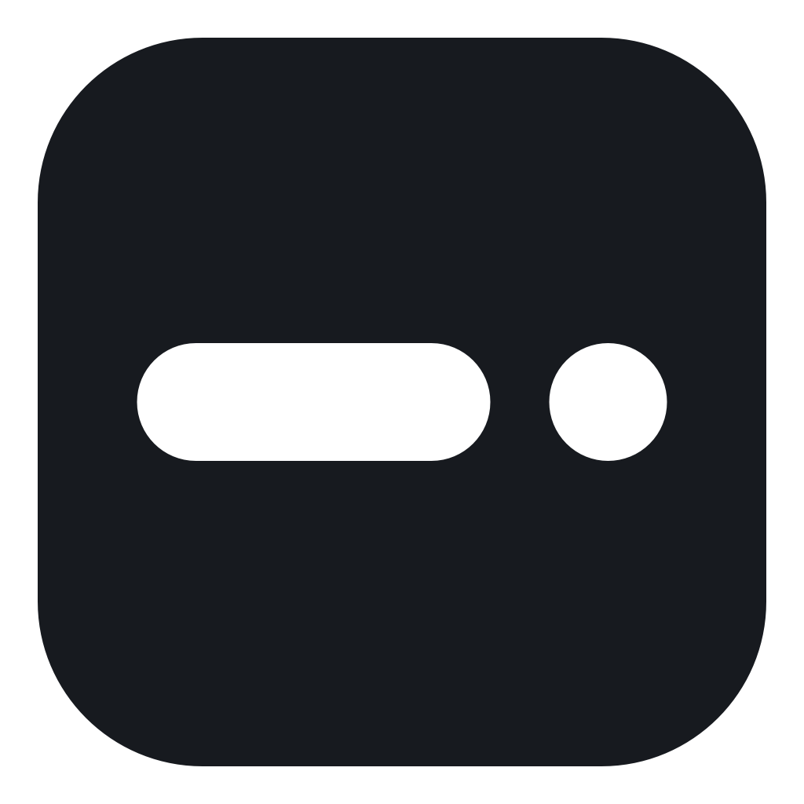

<p align="center"></p>
<h1 align="center">LessBar</h1>
<p align="center">A little less in your Mac menu bar.</p>
<p align="center"><a href="https://github.com/devnjw/LessBar/releases">Download</a> · <a href="docs/README.ko.md">한국어</a> · <a href="https://github.com/devnjw/LessBar/issues">Report a bug</a></p>

Hide menu bar icons, then click the chevron to reveal them. Optional hover reveal keeps the same simple controls.

## Install

1. Download the **universal `.dmg`** from [Releases](https://github.com/devnjw/LessBar/releases). It includes Apple Silicon and Intel builds. Choose the DMG under **Assets**, not GitHub's source-code archive.
2. Open it and drag **LessBar** to **Applications**.
3. Open LessBar from Applications and configure it in the settings window. There is no Dock icon; reopen the app from Applications or Raycast to return to settings.

The release notes state whether a build is Apple-notarized. A file labeled **unnotarized** is a developer preview and may be blocked by macOS. Prefer a notarized release; do not disable Gatekeeper. Developers can also [build from source](#build-from-source).

**Requirements:** macOS 13–26. Hiding is disabled on macOS 27 and later. Currently tested interactively on macOS 26.6.2 / Apple Silicon; Intel binaries are built, but Intel hardware and older macOS versions still need testing.

## Use

- Hold **⌘ Command** over the menu bar to reveal all sections and their boundaries, then drag icons across a boundary to choose which ones are hidden. Rearranging is always available; no setting is required.
- Click the chevron to reveal or hide icons when hover is off. Right-click it for **Settings** and **Quit**.
- Optionally enable **Reveal on Hover** to reveal icons over empty menu bar space. With Accessibility access, hover hides the chevron; without permission, the chevron stays available. Right-click empty menu bar space for the same native menu.
- Reopen LessBar from Applications or Raycast for settings, to change settings such as **Launch at Login**.

English and Korean follow your macOS language preference. While Settings is open, including when minimized, LessBar appears in the Dock and ⌘Tab. Closing Settings returns to menu-bar-only mode and keeps LessBar running. To update, quit LessBar, replace the app in Applications, then reopen it. There is no automatic updater.

## Recovery and limits

Reopen LessBar from Applications to show all icons and open settings. Quitting restores hidden icons. Display changes briefly expand the icons while layout settles, then restore the previous shared visibility state.

With Accessibility access, LessBar automatically moves the active screen-sharing control into the always-visible section to the right of its chevron. It leaves controls that are already on the right in place. If macOS rejects the move, settings show a message and the control stays visible; reopening LessBar retries it.

LessBar also checks for menu bar overlap and moves its reveal button away from other items. It briefly retries during system layout changes and expands if a safe position cannot be found.

This is an early release using a status item's width to hide neighbors. Notched displays can still run out of space; LessBar does not copy icons into a second bar. Visibility is synchronized across native menu bars; full-screen Spaces, notched or differently arranged displays, Intel hardware and older systems still need further interactive testing. It cannot restore icons disabled in another app's preferences.

## Privacy

No analytics, network requests, account or Screen Recording access. Accessibility access identifies the system screen-sharing control and reorders it using Command-drag events. Hover detection uses the same permission to read application-menu positions and sizes. The app reads menu bar identifiers and geometry without capturing images or titles. Launch at Login is opt-in and managed by macOS.

## Build from source

Requires Xcode 16 or newer (Swift 6+) with its command-line tools selected.

```sh
git clone https://github.com/devnjw/LessBar.git
cd LessBar
swift test
bash scripts/build-app.sh
open dist/LessBar.app
```

For both Mac architectures:

```sh
bash scripts/build-app.sh --universal
```

Local builds are ad-hoc signed. Move the app to `/Applications` or `~/Applications` before enabling Launch at Login. Do not run multiple copies at once.

See [Architecture](docs/ARCHITECTURE.md), [Contributing](CONTRIBUTING.md) and [Release instructions](docs/RELEASING.md).

## License

[MIT](LICENSE). The repository and initial preview are available at no charge.

## Settings

Use the chevron or hover to reveal icons. The native menu provides **Settings** and **Quit**; only Quit has a shortcut (**⌘Q**). Reopening LessBar still reveals icons for recovery.

The main window has three settings: **Launch at Login**, **Reveal on Hover**, and **Automatically Hide**. Launch at Login and hover reveal default to off; automatic hiding defaults to on. While hover is enabled, Automatically Hide stays on and cannot be changed. Turning hover off restores the previous automatic-hide choice, even after restarting the app. Existing choices are preserved when upgrading.

Click the **Timing** title row or chevron to expand it. The window grows smoothly downward with its top edge fixed. Adjust the hover delay (0–2 seconds) and hide delay (0–10 seconds), both in 0.1-second steps. Each control is enabled when its corresponding feature is on. Automatic hiding starts after the pointer leaves the menu bar and waits while a menu, drag, or settings window is active. Zero hides as soon as those interactions finish.

The chevron hides only while hover is enabled with Accessibility permission, and returns if permission is lost or hover is turned off. Command-drag editing temporarily displays the boundaries. Empty-space click reveal and application-menu hiding are no longer enabled. All native menu bars share one visibility state, with per-display collision checks and recovery controls.

Upgrades preserve an already-enabled always-hidden section and its placement. Right-click the chevron or empty menu bar space in hover mode and choose **Show all sections temporarily**, or reopen LessBar, to recover those items. Command-drag can move them back into the normal hidden or always-visible section. New installs do not create an always-hidden section.
